

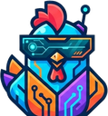

# Ramas

**Tablero liviano para un equipo chico y sus agentes de IA.**
De un audio grabado a la feature terminada, con Claude Code y Codex escribiendo directamente en las tareas.

[▶ Ver demo completa (1:41)](media/ramas-demo.mp4)

---

## La idea

Todo es un **nodo** (`R-42`). Una **idea cero** —muchas veces un audio— se ramifica en tareas, y cada tarea en subtareas, en un árbol de profundidad libre. Cada nodo tiene estado, prioridad, responsable, adjuntos y una **bitácora** donde personas y agentes dejan resúmenes, decisiones, preguntas abiertas y bloqueos.

Personas y agentes trabajan en el mismo tablero: los humanos desde el navegador, los agentes vía **MCP**, **API REST** o **CLI**.

## Pantallas

### Tablero kanban
Arrastrar y soltar, filtros por persona y tipo, y el camino padre → hijo iluminado al seleccionar una tarea.

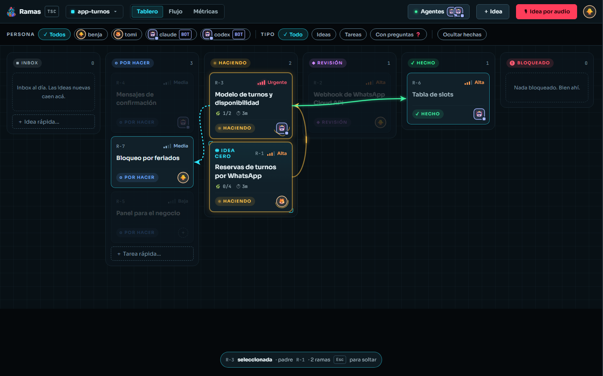

### Flujo de ramificación
El árbol completo de una idea, con conectores que muestran el estado de cada rama.

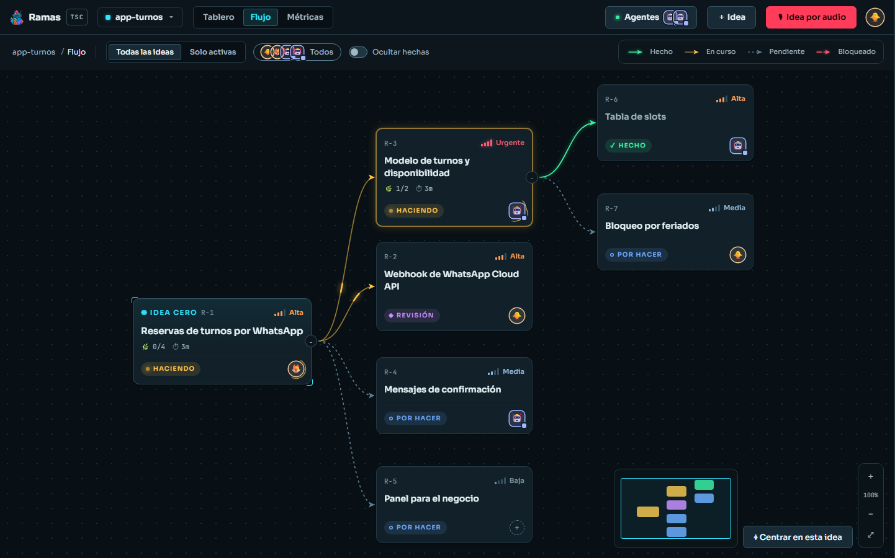

### Detalle de tarea
Estado, prioridad, responsable (humano o agente), adjuntos, audio, subramas y bitácora.

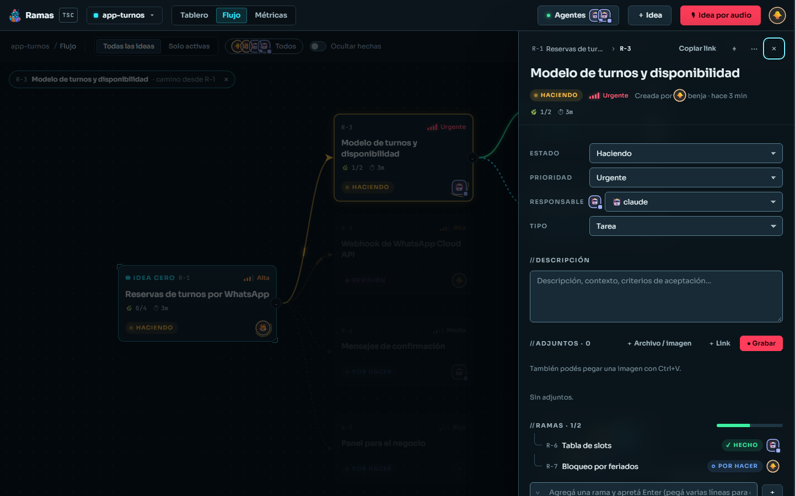

### Idea por audio
Grabar y crear la idea en un paso. El audio se reproduce, se descarga y admite transcripción.

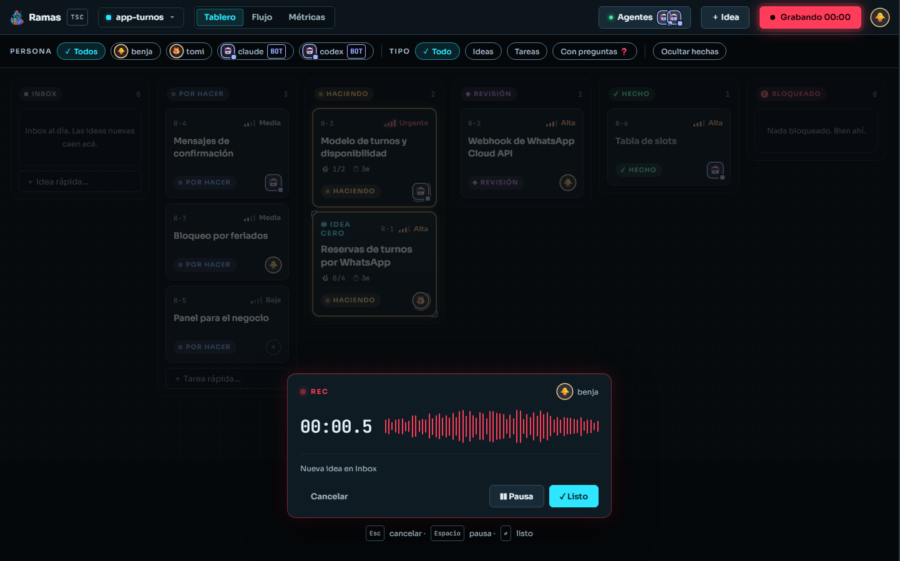

### Métricas
Tiempo por tarea e idea, lead time, avance, quién cerró qué (personas y agentes por separado) y preguntas abiertas.

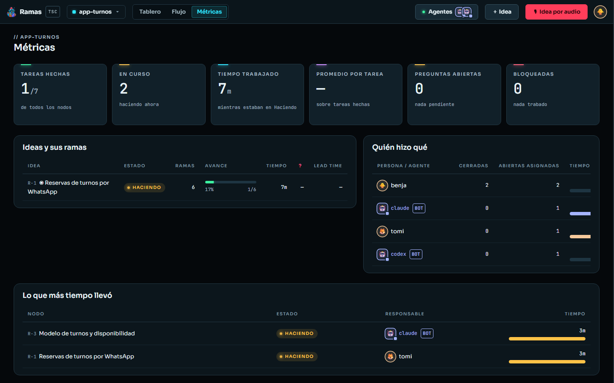

### Conexión de agentes
Instrucciones listas para conectar Claude Code o Codex al workspace.

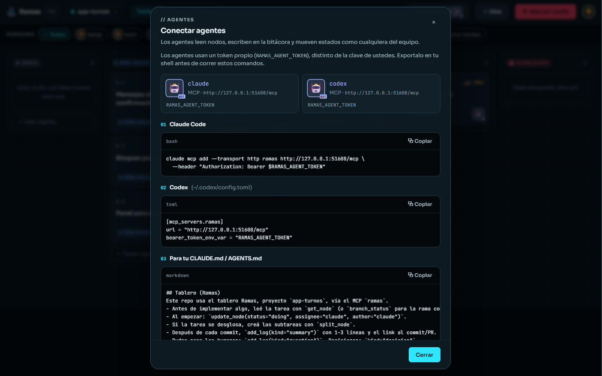

### Mobile

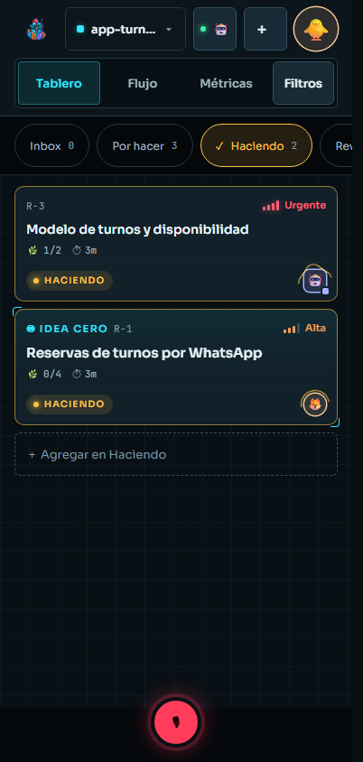
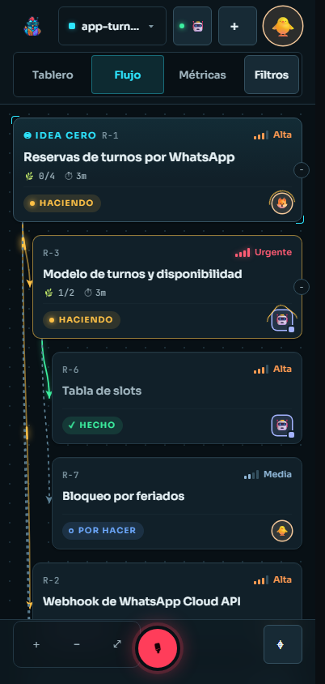
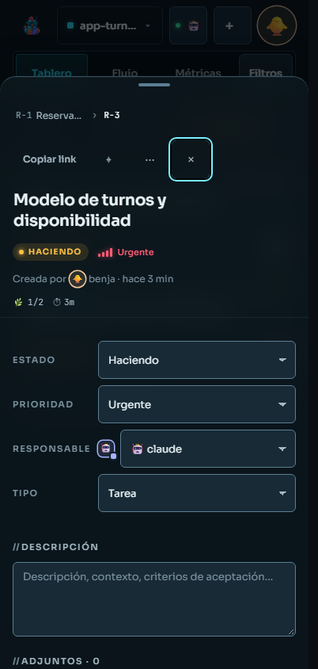
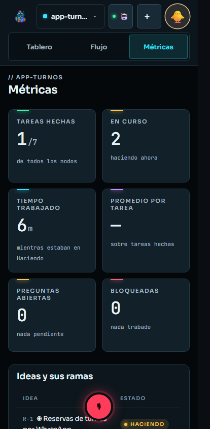

## Qué trae

- **Tres vistas:** kanban, árbol de ramificación y métricas.
- **Audio** como entrada de primera clase: grabar una idea o adjuntar audio a cualquier tarea.
- **Adjuntos:** archivos, imágenes (también pegando con Ctrl+V) y links.
- **Bitácora tipada:** resumen, decisión, pregunta, bloqueo, nota y commit.
- **Cronometraje automático** del tiempo en "Haciendo".
- **Sin login:** clave de equipo y "¿quién sos?" con avatar. Los agentes usan un token aparte.
- **Integración con agentes** por MCP, API REST documentada y CLI.
- **Accesible:** contraste AA en todo el texto, estados que nunca dependen solo del color.

## Stack

| Capa | Tecnología |
|---|---|
| Backend | Python · FastAPI · SQLite · MCP |
| Frontend | JavaScript puro, sin build ni framework |
| Design system | Tokens CSS propios, componentes `rm-*`, plantillas JS |
| Infra | Docker · Caddy (HTTPS automático) |
| Tests | pytest · Playwright (API, UI, visual, accesibilidad) |

## Qué hay en este repo

Este repositorio es una **vitrina**. Incluye:

- [`frontend/`](frontend/) — la interfaz completa (JS puro + CSS del design system).
- [`design-system/`](design-system/) — tokens, componentes, plantillas, referencias por pantalla y la [guía de diseño](design-system/GUIA.md).
- [`media/`](media/) — capturas y video de demo.

El backend, la integración MCP, la CLI, la infraestructura de despliegue y la suite de tests **no se publican**.

## Licencia

© 2026 TSC — Benjamín Angelone. **Todos los derechos reservados.**
El código se publica solo para que pueda verse. No está permitido usarlo, copiarlo, modificarlo ni distribuirlo sin autorización escrita. Ver [LICENSE](LICENSE).

## Contacto

¿Te interesa algo parecido para tu equipo? Escribime por [GitHub](https://github.com/BenjAngelone).
